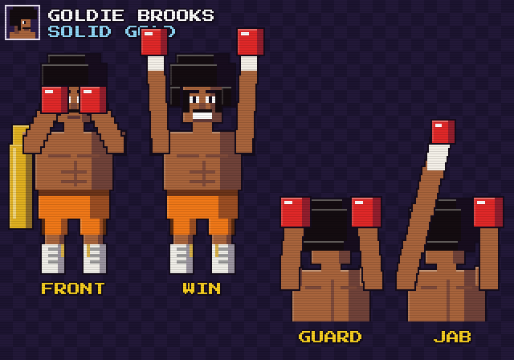
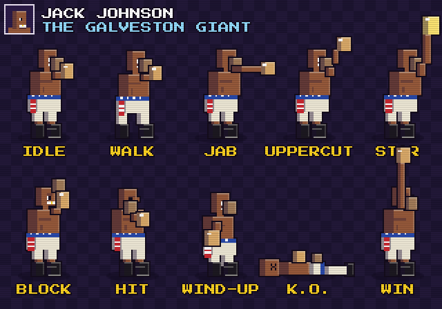

# Knockout Alley

A Punch-Out-style boxing game drawn in a 16-bit, Streets of Rage-inspired style. It is one HTML file with no dependencies: open `index.html` in a browser to play.

You see your boxer from behind and face one opponent at a time. Work your way up a six-fight circuit, from the Minor Circuit to a title bout against the world champion.

## Fighters

| Fighter | Style | Power | HP | Speed |
| --- | --- | --- | --- | --- |
| Goldie Brooks | "Solid Gold": afro, gold robe, orange satin trunks | ★★★★ | ★★★★ | ★★★★ |
| Jack Johnson | "The Galveston Giant", heavyweight champion 1908–1915 | ★★★★★ | ★★★★ | ★★★ |

## The circuit

| # | Opponent | Circuit | Watch out for |
| --- | --- | --- | --- |
| 1 | Alley Cat | Minor | Slow jabs and hooks |
| 2 | Speedy Rico | Minor | Three-jab rushes; circles at range |
| 3 | Big Tony | Major | Stalks you; body blows and uppercuts, low guard |
| 4 | Bruno Brick | Major | Uppercuts and a huge haymaker |
| 5 | Vinnie Volt | World | Fast rushes, short wind-ups |
| 6 | Granite Grant | Title bout | Everything, with the shortest tells |

## Controls

| Action | Keyboard | Touch |
| --- | --- | --- |
| Move around the ring | Arrow keys (Up steps in, Down steps back) | D-pad |
| Dodge left / right | A / D (or Q / E) | « » |
| Duck | S (or Shift) | DCK |
| Block (hold) | V | BLK |
| Jab (left, to the head) | Z (or J) | JAB |
| Hook (right, to the head) | X (or K) | HOOK |
| Body punch | C | BDY |
| Star uppercut | Space (or L) | ★ |
| Start / get up | Enter (mash punches to get up) | START |
| Pause | P / Esc | — |
| Sound on/off | M | SOUND |

## How to fight

- **Use the whole ring.** You and your opponent both move. Your punches only land when you're in range and lined up with them. When you're not, a yellow arrow shows which way to go. Step back during a wind-up and their punch falls short, which opens them up for a counter.
- **Know their style.** Pressure fighters like Big Tony stalk you. Out-boxers like Speedy Rico and Vinnie Volt circle at range. A badly hurt opponent backs off. Landed punches push opponents back toward the ropes.

- **Read the tell.** Opponents glint and flash a glove before they punch.
  - Jabs and hooks: dodge, duck or block.
  - Uppercuts: dodge, or block for reduced damage. Ducking gets you hit harder.
  - Body blows: dodge or block. Ducking doesn't help.
  - Haymakers: dodge or duck.
- **Counter.** Hit an opponent during their wind-up, or right after you make them miss, for 1.5x damage and a star (up to 3).
- **Beat the guard.** A high guard stops head shots but not body punches. A low guard stops body punches but not head shots.
- **Hearts are stamina.** A blocked punch costs 1 heart and getting hit costs 3. At 0 hearts you are tired and can't punch until you recover. Making an opponent miss gives a heart back.
- **Taking a hit costs you a star.**
- **Knockdowns.** The ref counts to 10. Three knockdowns in one round is a T.K.O. If you go down, mash the punch buttons to get up.
- **Rounds.** Fights are 3 rounds. If nobody is knocked out, the judges decide on points.

## The gym

Win a fight to earn a purse. A K.O. pays a bonus, and so does winning without being knocked down. Spend the money between fights:

| Upgrade | Effect | Levels |
| --- | --- | --- |
| Power | Punches hit 15% harder | 5 |
| Stamina | Max HP +20 | 5 |
| Footwork | Recover 15% faster | 3 |
| Iron Chin | Take 10% less damage | 4 |
| Star Start | +1 star at the opening bell | 3 |
| Big Heart | +5 max hearts | 3 |
